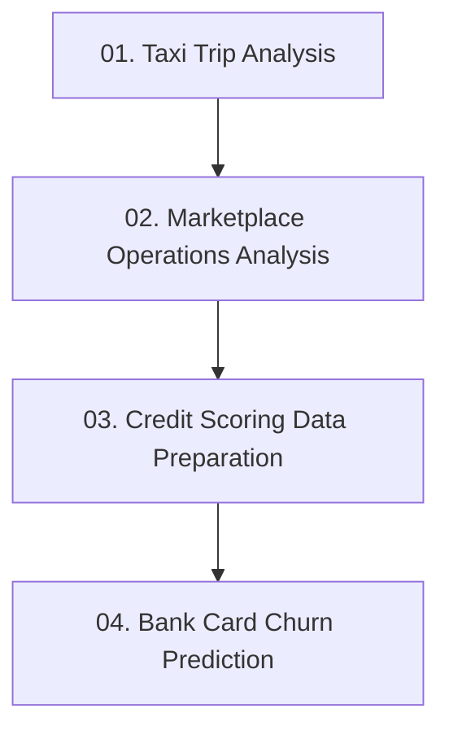

# Data Science & Machine Learning Portfolio

Individual educational projects in data analysis, credit-risk data preparation, and supervised learning, presented for **Data Science / Machine Learning internship opportunities**.

The projects cover different parts of the workflow: cleaning raw data, investigating business questions with SQL, defining targets, engineering features, and evaluating a predictive model.

**Review shortcuts:** [ML training notebook](https://github.com/smile0071/uzcard_academy_projects/blob/HEAD/bank-card-churn-prediction/work.ipynb) · [SQL case study](https://github.com/smile0071/uzcard_academy_projects/blob/HEAD/marketplace-operations-analysis/var.ipynb) · [All projects](#project-roadmap)

> These are learning projects, not production systems. Descriptions distinguish implemented code from proposed methods and presentation-only results. Saved notebook outputs have not been independently reproduced for this portfolio.

---

## Contents

- [Featured Projects](#featured-projects)
- [Project Roadmap](#project-roadmap)
- [Learning & Practice](#learning--practice)
- [Technologies & Skills](#technologies--skills)
- [Data & Reproducibility](#data--reproducibility)

## Featured Projects

### Marketplace Operations Analysis

**Question:** How do order volumes, payment failures, and customer complaints change over time, and which areas deserve further investigation?

An exploratory business-analysis case study connecting SQL queries, statistical tests, visualizations, and recommendations.

| Component            | Implemented work                                                                |
| -------------------- | ------------------------------------------------------------------------------- |
| Data exploration     | Investigating table relationships and date coverage                             |
| Payment analysis     | Monthly order trends; failure rates by payment method, hour, and attempt number |
| SQL techniques       | Joins, grouped aggregates, conditional aggregates, CTEs, and `LAG`              |
| Statistical analysis | A two-proportion z-test and merchant-level binomial tests                       |
| Customer feedback    | Review ratings, merchant comparisons, complaint reasons, and monthly patterns   |

**Tools:** PostgreSQL, pandas, Matplotlib, SciPy, statsmodels.

**Review note:** Featured for its case-study structure, not as a finished or independently validated solution. The analysis identifies associations; it does not establish that payment failures caused later customer loss. Some aggregations and statistical assumptions need review. Initial setup is incomplete, and a saved plotting error remains.

[Open notebook](https://github.com/smile0071/uzcard_academy_projects/blob/HEAD/marketplace-operations-analysis/var.ipynb) · [Browse project](https://github.com/smile0071/uzcard_academy_projects/tree/HEAD/marketplace-operations-analysis) · [Table schema](https://github.com/smile0071/uzcard_academy_projects/blob/HEAD/marketplace-operations-analysis/columns_202607132046.csv) · [Assignment](https://github.com/smile0071/uzcard_academy_projects/blob/HEAD/marketplace-operations-analysis/zd.md)

## Project Roadmap

A suggested reading order from analytical foundations to predictive modeling. It is a map of existing work, not a completion timeline or a list of planned projects. **For an ML-focused review, start with stage 04.**

| Stage | Project                                                                                                                           | Focus                                                                        | Main entry point                                                                                                                      |
| ----- | --------------------------------------------------------------------------------------------------------------------------------- | ---------------------------------------------------------------------------- | ------------------------------------------------------------------------------------------------------------------------------------- |
| 01    | [Taxi Trip Analysis](https://github.com/smile0071/uzcard_academy_projects/tree/HEAD/taxi-trip-analysis)                           | Data cleaning, joins, descriptive statistics, and visualization              | [Notebook](https://github.com/smile0071/uzcard_academy_projects/blob/HEAD/taxi-trip-analysis/week03_pandas_taxi.ipynb)                |
| 02    | [Marketplace Operations Analysis](https://github.com/smile0071/uzcard_academy_projects/tree/HEAD/marketplace-operations-analysis) | SQL investigation, time trends, and statistical testing                      | [Notebook](https://github.com/smile0071/uzcard_academy_projects/blob/HEAD/marketplace-operations-analysis/var.ipynb)                  |
| 03    | [Credit Scoring Data Preparation](https://github.com/smile0071/uzcard_academy_projects/tree/HEAD/credit-scoring-data-preparation) | Target definition, observation maturity, and feature exploration             | [Notebook](https://github.com/smile0071/uzcard_academy_projects/blob/HEAD/credit-scoring-data-preparation/week_scoring_dataset.ipynb) |
| 04    | [Bank Card Churn Prediction](https://github.com/smile0071/uzcard_academy_projects/tree/HEAD/bank-card-churn-prediction)           | Rolling-window features, temporal snapshots, XGBoost, and ranking evaluation | [Training notebook](https://github.com/smile0071/uzcard_academy_projects/blob/HEAD/bank-card-churn-prediction/work.ipynb)             |

## Learning & Practice

### Bank Card Churn Prediction

**Question:** Can transaction and engagement history help rank cardholders by the risk of future inactivity?

The most extensive ML implementation in this repository. Churn is represented by a proxy target based on the absence of successful transactions in a future observation window, rather than a recorded account closure.

**Implemented work:**

- Transaction-gap exploration and construction of activity-based snapshots.
- Feature engineering over 7-, 14-, 30-, and 60-day windows, including transaction and engagement aggregates.
- Time-based training, validation, and test snapshots.
- XGBoost training, ROC-AUC, average precision, Recall@10%, and feature-importance analysis.

**Tools:** Python, PostgreSQL, SQLAlchemy, pandas, NumPy, scikit-learn, XGBoost, Matplotlib, Seaborn.

**Current limits:** The notebooks do not form a single reproducible pipeline. Target and cohort settings differ between sections, historical feature availability needs review, and the CLV section contains a saved error. Parts of the companion notebook use manually entered results; the training notebook is the primary implementation. No measured retention uplift or ROI is claimed here.

[Training notebook](https://github.com/smile0071/uzcard_academy_projects/blob/HEAD/bank-card-churn-prediction/work.ipynb) · [Companion analysis](https://github.com/smile0071/uzcard_academy_projects/blob/HEAD/bank-card-churn-prediction/week_churn_model.ipynb) · [Assignment](https://github.com/smile0071/uzcard_academy_projects/blob/HEAD/bank-card-churn-prediction/zd.md)

### Credit Scoring Data Preparation

**Question:** How should a credit-risk target and candidate features be constructed from application, contract, payment, and bureau data before model training?

**Implemented work:**

- Inspection of PostgreSQL tables, column definitions, and relationships.
- A DPD30+ target implementation using payments scheduled within a six-month window, with rejected applications and immature contracts handled separately.
- Cohort trends, missing-value exploration, and approved/rejected comparisons.
- Selection of a bureau snapshot before the decision date, plus separate application, bureau, and card-activity feature queries.

**Tools:** Python, PostgreSQL, SQLAlchemy, pandas, NumPy, Matplotlib.

**Current limits:** Target-horizon and maturity rules need refinement, some feature queries require stricter historical cutoffs, and the final training dataset has not been assembled. Connection setup is incomplete. Supplementary presentation screenshots describe a different target/model setup; model-training code is not included in this project, so those model metrics are not presented as verified results.

[Main notebook](https://github.com/smile0071/uzcard_academy_projects/blob/HEAD/credit-scoring-data-preparation/week_scoring_dataset.ipynb) · [SQL exploration](https://github.com/smile0071/uzcard_academy_projects/blob/HEAD/credit-scoring-data-preparation/var.ipynb) · [Data dictionary](https://github.com/smile0071/uzcard_academy_projects/blob/HEAD/credit-scoring-data-preparation/columns_202608042219.md) · [Presentation screenshots](https://github.com/smile0071/uzcard_academy_projects/tree/HEAD/credit-scoring-data-preparation/presentation/photos) · [Assignment](https://github.com/smile0071/uzcard_academy_projects/blob/HEAD/credit-scoring-data-preparation/zd.md)

### Taxi Trip Analysis

**Question:** What can trip and driver records reveal about revenue, demand, cancellations, vehicle classes, and payment preferences?

**Implemented work:**

- Normalizing status values, cleaning fare strings, and removing duplicate rows.
- Joining trip and driver records and comparing aggregated metrics.
- Calculating outlier counts, median speed, and a distance percentile.
- Plotting hourly trip counts and payment-method frequencies.

**Tools:** Python, pandas, NumPy, Matplotlib.

**Scope:** Code and saved answers are present for all ten assignment questions. Both CSV inputs are included, making this the simplest project to inspect without a database. A fresh execution and dependency compatibility check have not been performed for this portfolio.

[Notebook](https://github.com/smile0071/uzcard_academy_projects/blob/HEAD/taxi-trip-analysis/week03_pandas_taxi.ipynb) · [Trips CSV](https://github.com/smile0071/uzcard_academy_projects/blob/HEAD/taxi-trip-analysis/hw3_trips.csv) · [Drivers CSV](https://github.com/smile0071/uzcard_academy_projects/blob/HEAD/taxi-trip-analysis/hw3_drivers.csv)

## Technologies & Skills

The following tools and techniques are represented in the available source code; this is not a claim of production experience.

| Area                      | Evidence in the projects                                                                                |
| ------------------------- | ------------------------------------------------------------------------------------------------------- |
| Python data analysis      | pandas and NumPy for cleaning, joins, grouping, descriptive statistics, and feature construction        |
| Relational data           | PostgreSQL and SQLAlchemy; SQL joins, CTEs, conditional aggregates, window functions, and lateral joins |
| Machine learning          | XGBoost training and scikit-learn metrics in the card-inactivity study                                  |
| ML dataset design         | Proxy targets, observation windows, cohort maturity, and temporal snapshot evaluation                   |
| Statistical analysis      | statsmodels proportion tests and SciPy binomial tests in the marketplace study                          |
| Visualization & reporting | Matplotlib, Seaborn, Jupyter notebooks, and written analytical conclusions                              |

## Data & Reproducibility

### Data context

The inputs are educational datasets, and the presentation screenshots are personal study materials. The projects are individual work and do not document a live customer deployment. Database extracts and row-level notebook outputs should still be handled carefully when reused or redistributed.

### What is available

| Project                         | Inputs and setup                                                                                                                                                                                                                        | Reproduction limits                                                                                                               |
| ------------------------------- | --------------------------------------------------------------------------------------------------------------------------------------------------------------------------------------------------------------------------------------- | --------------------------------------------------------------------------------------------------------------------------------- |
| Taxi Trip Analysis              | Two local CSV files beside the notebook; relative paths expect the project folder as the working directory                                                                                                                              | No project-specific dependency manifest; a clean run has not been checked                                                         |
| Marketplace Operations Analysis | Queries against PostgreSQL `ds_*` tables; schema and saved outputs are included                                                                                                                                                         | Requires database access and missing initial import/connection setup                                                              |
| Credit Scoring Data Preparation | Queries against PostgreSQL `scoring_*` tables; a data dictionary and project-specific [requirements file](https://github.com/smile0071/uzcard_academy_projects/blob/HEAD/credit-scoring-data-preparation/requirements.txt) are included | Connection placeholders and dataset logic need attention; no final dataset export is included                                     |
| Bank Card Churn Prediction      | Queries against PostgreSQL `churn_*` tables; an externally supplied `DSN` is required; a local SQL dump is under `bd/dump.sql`                                                                                                          | Dump completeness and restoration have not been verified; no project-specific dependency manifest or clean-kernel run is provided |

### Reviewing and running the work

1. Start with the linked notebooks to review the source, plots, and saved outputs on GitHub.
2. Read the corresponding assignment and schema where available to understand the task and input tables.
3. For local execution, prepare a Python/Jupyter environment with the dependencies used by that project. The scoring requirements file is **not** a repository-wide environment specification.
4. Database-backed notebooks additionally require the appropriate PostgreSQL tables, a configured connection, and attention to the limitations documented above. Keep credentials out of committed files.

This README is a review guide, not a tested one-command setup. Saved metrics and plots are historical notebook outputs, not an independently validated benchmark or evidence of production readiness.
